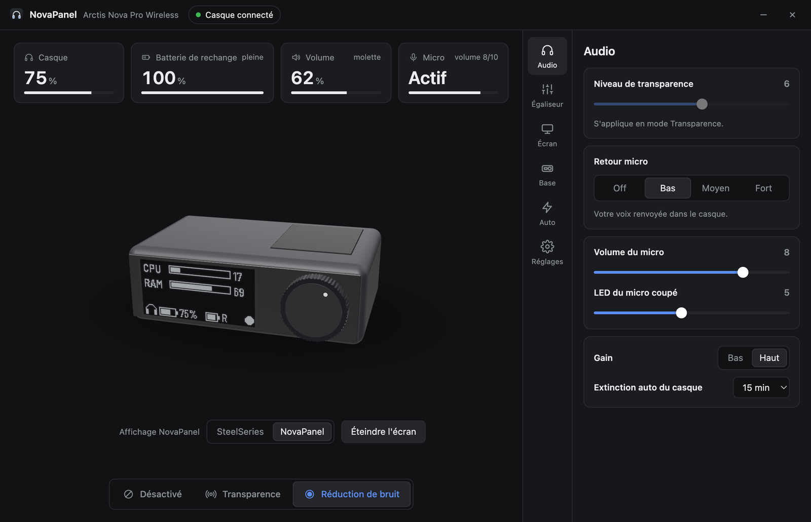
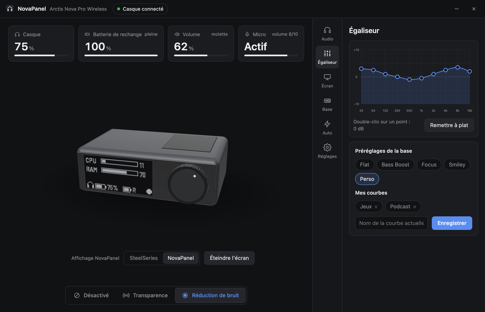
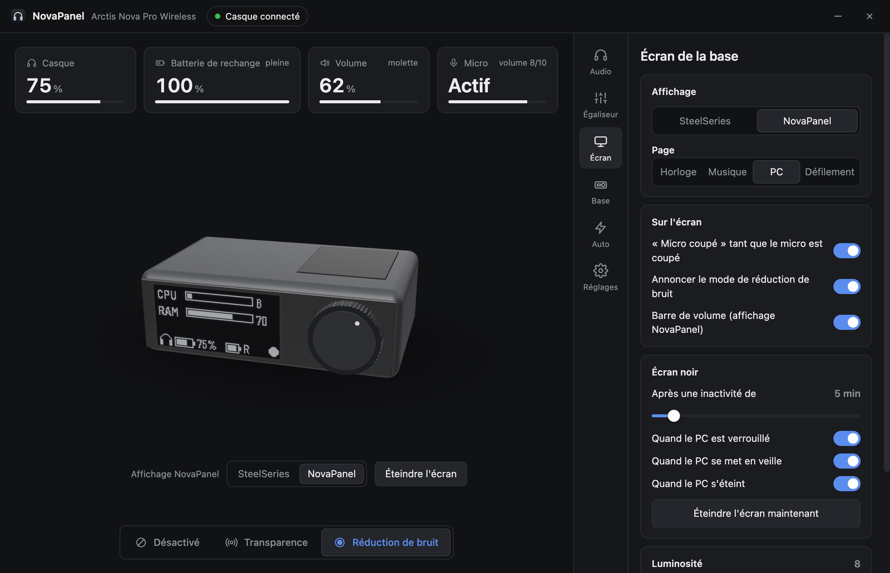

<div align="center">


# NovaPanel

**Un remplaçant léger de SteelSeries GG pour l'Arctis Nova Pro Wireless.**
Réduction de bruit, égaliseur, écran OLED de la base et batteries, sans GG en arrière-plan.

[English](README.md) · Français

[](https://github.com/thibautgnt/NovaPanel/releases/latest)
[](https://github.com/thibautgnt/NovaPanel/releases)
[](https://github.com/thibautgnt/NovaPanel/actions/workflows/ci.yml)
[](LICENSE)

[](https://github.com/sponsors/thibautgnt)



</div>

## Pourquoi

SteelSeries GG est une application lourde, avec plusieurs services en arrière-plan, juste pour changer quelques réglages qui sont de toute façon enregistrés dans la base. NovaPanel parle directement à la base en USB et fait le même travail dans une petite application qui reste dans la zone de notification.

> [!IMPORTANT]
> **NovaPanel s'adresse à ceux qui n'utilisent pas SteelSeries Sonar.** Sonar (le mixeur audio virtuel : canaux jeu / chat / média, son spatial, égaliseur paramétrique) fait partie de GG et en a besoin pour fonctionner. Si vous utilisez Sonar, gardez GG. NovaPanel remplace tout le reste : les réglages du casque, de la base et de l'écran.

## Fonctionnalités

- **Casque** : réduction de bruit active / transparence (et son niveau), retour micro, volume du micro, luminosité de la LED micro coupé, gain, extinction automatique.
- **Égaliseur 10 bandes** : courbe à glisser, préréglages de la base, courbes personnelles enregistrables.
- **Écran de la base**
  - s'éteint quand l'ordinateur est inactif, verrouillé, en veille ou éteint (fini le marquage de l'OLED) ;
  - affiche « MICRO COUPÉ » tant que le micro est coupé ;
  - annonce le mode de réduction de bruit et affiche une barre de volume ;
  - écrans NovaPanel au choix : horloge, musique en cours, CPU / RAM, ou défilement ;
  - aperçu en direct de la base en 3D dans l'application.
- **Base** : luminosité et assombrissement de l'écran, sortie ligne, mode sans fil, Bluetooth.
- **Batteries** : icône dans la zone de notification avec le niveau du casque, alerte de batterie faible, notification quand la batterie de rechange est pleine.
- **Automatisations** : égaliseur par application (bascule quand un jeu passe au premier plan), raccourcis globaux (`Ctrl+Alt+N` mode de réduction de bruit, `Ctrl+Alt+B` écran noir, `Ctrl+Alt+P` écran suivant).
- **Interrupteur GG** : arrête GG et l'empêche de démarrer avec Windows, ou le relance pour les mises à jour du firmware.

<table>
<tr>
<td></td>
<td></td>
</tr>
</table>

## Installation

### Windows

1. Téléchargez **NovaPanel-Windows.zip** depuis la [dernière version](https://github.com/thibautgnt/NovaPanel/releases/latest).
2. Décompressez-le où vous voulez (par exemple `C:\Program Files\NovaPanel` ou vos Documents) et lancez `NovaPanel.exe`.
3. Dans **Réglages**, activez *Lancer NovaPanel au démarrage* et, si vous le souhaitez, arrêtez GG.

L'application n'est pas encore signée : au premier lancement, Windows SmartScreen peut demander une confirmation (*Informations complémentaires → Exécuter quand même*).

### macOS

1. Téléchargez **NovaPanel-macOS.zip** depuis la [dernière version](https://github.com/thibautgnt/NovaPanel/releases/latest) et placez `NovaPanel.app` dans *Applications*.
2. L'application n'est pas notarisée : la première fois, faites un clic droit puis *Ouvrir*, ou lancez `xattr -dr com.apple.quarantine /Applications/NovaPanel.app`.

### Linux

Installez depuis les sources (ci-dessous), puis autorisez votre utilisateur à accéder à la base :

```sh
sudo cp packaging/linux/70-novapanel.rules /etc/udev/rules.d/
sudo udevadm control --reload && sudo udevadm trigger
```

### Depuis les sources (tous systèmes)

Python 3.11 ou plus récent :

```sh
pip install git+https://github.com/thibautgnt/NovaPanel.git
novapanel
```

Options : `--tray` démarre réduit dans la zone de notification, `--debug` affiche les échanges USB.

## Compatibilité

| Base | ID USB | État |
| --- | --- | --- |
| Arctis Nova Pro Wireless (PC / PlayStation) | `1038:12E0` | Testée |
| Arctis Nova Pro Wireless pour Xbox | `1038:12E5`, `1038:225D` | Même protocole, pas encore testée |

L'Arctis Nova Pro filaire (GameDAC Gen 2) utilise un autre protocole et n'est pas prise en charge.

| Fonction | Windows | macOS | Linux |
| --- | :---: | :---: | :---: |
| Casque, égaliseur, écran, batteries | ✓ | ✓ | ✓ |
| Écran noir en cas d'inactivité / verrouillage / veille | ✓ | ✓ | – |
| Égaliseur par application | ✓ | ✓ | – |
| Écran « musique en cours » | ✓ | – | – |
| Raccourcis globaux, interrupteur GG | ✓ | – | – |

NovaPanel ne tourne que sur ordinateur. Les consoles continuent de fonctionner normalement avec la base : les réglages faits avec NovaPanel sont enregistrés dans la base et restent actifs quand elle est branchée sur une console.

La prise en charge de macOS et Linux est récente : si quelque chose ne marche pas chez vous, [ouvrez une issue](https://github.com/thibautgnt/NovaPanel/issues/new/choose) avec la sortie de `novapanel --debug`.

## Questions fréquentes

**GG et NovaPanel peuvent-ils tourner en même temps ?**
Oui, mais ils vont écraser les réglages l'un de l'autre. Le mieux est d'arrêter GG depuis **Réglages → SteelSeries GG**.

**Où sont enregistrés mes réglages ?**
Les réglages du casque et de la base sont dans la base. Ceux de NovaPanel sont dans `%APPDATA%\NovaPanel` (Windows), `~/Library/Application Support/NovaPanel` (macOS) ou `~/.config/NovaPanel` (Linux).

**Comment mettre à jour le firmware de la base ?**
Les mises à jour du firmware passent encore par GG. Utilisez *Réactiver GG* dans **Réglages**, faites la mise à jour, puis arrêtez-le à nouveau.

## Compiler

```sh
pip install -e .[dev]
pytest
python packaging/build.py   # dist/NovaPanel (Windows) ou dist/NovaPanel.app (macOS)
```

Pousser un tag `v*` compile les deux paquets sur GitHub Actions et les joint à la version.

## Remerciements

Le protocole de la base a été décodé par ces projets :

- [ggoled](https://github.com/Donimax/ggoled) : écran OLED
- [HeadsetControl](https://github.com/Sapd/HeadsetControl) : égaliseur, retour micro, batterie
- [Arctis Sound Manager](https://github.com/loteran/Arctis-Sound-Manager) : réduction de bruit, transparence et autres réglages

Police de l'écran de la base : [Barlow](https://github.com/jpt/barlow) (SIL Open Font License). Aperçu 3D : [three.js](https://threejs.org) (MIT).

## Soutenir le projet

NovaPanel est gratuit et open source. S'il vous évite de faire tourner GG, vous pouvez [soutenir le projet sur GitHub](https://github.com/sponsors/thibautgnt).

## Licence

[MIT](LICENSE). NovaPanel est un projet non officiel, sans lien avec SteelSeries ni approuvé par SteelSeries. Arctis et SteelSeries sont des marques de SteelSeries ApS.
